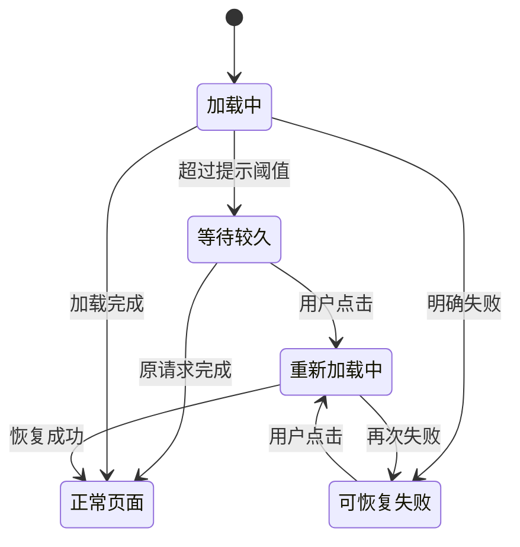

# beta.6 后续修复与验收任务计划

状态：代码及 Beta 交付完成，实机待用户验证。`v3.0.23-beta.8` 已公开，五平台构建与29个资产哈希校验通过。2026-10-27 用户补充授权：完成代码并打一个 Beta，实机验收由用户明天执行；不自动安装到 mac-dbg / win-dbg，也不代部署 PC Web。

依据：[beta.6 实机验收摘要](../docs/acceptance/20261026-beta6-real-device-acceptance.md)、本机完整图文报告，以及用户本轮补充。**用户再次确认：macOS 上 Nuwax 的消息仍未出现在系统通知中心消息列表。该项按现存缺陷处理，列为首批 P1，不再仅归为“待验”。** 原报告保留当时观察，本计划记录新的问题状态。

## 一、修复任务与顺序

P1 为首批处理；P2 为随后处理。类型区分修复、定位、已有代码交付和补验，不把未测试的功能直接认定为缺陷。

| ID | 优先级 / 类型 | 任务 | 归属 | 完成条件 |
| --- | --- | --- | --- | --- |
| R01 | P1 / 缺陷定位与修复 | **macOS 消息未进入系统通知中心**：跟踪真实入站、筛选、原生投递、系统列表保留和点击唤回，修复实际断点 | 客户端 IM 接收器、原生通知模块 | 正常后台、非免打扰的真实私聊和群聊消息进入系统列表；横幅消失后仍能从列表看到并点击唤回。有截图和关联日志；权限已授权、角标变化、合成通知均不能替代 |
| R02 | P1 / 定位与修复 | 首次重启页面初始化失败：定位认证恢复、配置/用户/菜单请求和本地服务就绪之间的实际失败点 | PC Web 启动链 + 客户端服务门禁 | 找到可复现触发条件；修复前复现、修复后通过。覆盖正常重开及文件开关 OFF/ON 后重开；临时网络失败能手动恢复；不能只靠刷新成功关闭根因问题 |
| R03 | P1 / 体验修复 | **PC Web 初始化状态界面升级**：加载、等待较久、失败、正在重新加载四态，提供清晰且好看的恢复入口 | PC Web `AppStartup`、初始化边界与鉴权加载页 | 不白屏、不无限转圈；失败立即可刷新；慢请求自然恢复不被打断；重复点击只发起一次；浏览器与新旧客户端均适用 |
| R04 | P1 / 体验与恢复修复 | **WebView 加载失败状态升级**：与 R03 统一视觉，保留壳的窗口控制、刷新和设置入口；覆盖地址解析失败、主文档失败、进程崩溃与长时间等待 | 客户端 `NuwaxHostWebview`、首载覆盖层 | guest 完全未加载也能看到恢复界面；按失败类型重载/重建；旧回调不能覆盖新一轮页面；子资源失败和主动导航取消不误报整页失败 |
| R05 | P1 / 已有代码交付与复验 | 缺文件提示/状态、最近目录按电脑隔离，以及新客户端加载旧 PC Web 的 null 字段兼容 | PC Web + 客户端本机文件域 | 核对实际部署/包内是否含 `c3fe85e68`、`6de9e09a`；按旧页面/旧客户端/浏览器/本机/远端组合复验。不重复实现已有补丁，不仅凭 beta.7 版本号判断 |
| R06 | P2 / 定位与修复 | Dock 图标间歇消失但客户端仍在：采集发生时的应用身份、激活策略、主窗及进程状态 | 客户端窗口、托盘与 macOS 生命周期 | 在用户原始复现场景定位并验证；正常关闭主窗、隐藏、最小化、自启动、睡眠唤醒、升级后重开逐项验收。不能用单次“关闭主窗后正常”关闭间歇问题 |

实施顺序：R01 优先定位；R02 采证后修实际断点；R03/R04 作为一组独立的恢复体验交付，与根因修复分别记录；R05 复用已有实现补交付证据。按用户最新授权并行实施，真实设备操作与最终集成串行进行，不创建其他聊天或调度后台任务。

| 实施者 | 责任范围 | 隔离约定 |
| --- | --- | --- |
| mac_notifications | R01：客户端 IM 接收、现代通知模块及对应测试 | 不碰 renderer、main.ts 与总计划；设备仅只读采证 |
| web_startup_recovery | R02/R03：PC Web 启动恢复、鉴权边界、本地词典与测试 | 不碰文件路由、子模块与客户端仓 |
| client_webview_recovery | R04：客户端 renderer、首载覆盖与 guest 恢复 | 不碰主进程通知和 Dock；基座改动走商业 overlay |
| 主代理 | R05 核对、R06 Dock、真实设备协调、集成检查与证据收尾 | 保留两个仓库原有子模块 WIP，统一提交与交付 |

R03/R04 可以先提供可恢复体验，但两者上线不代表 R01/R02/R06 已修复。没有根因与实机证据的问题继续保持打开。

## 二、重点：加载失败与刷新界面

### 当前基础

- PC Web 已有 `AppStartup`：失败时出现重新加载按钮，等待 15 秒提示较久，刷新会整文档重载并防重复点击；本轮是在此基础上增强。
- 客户端已有 `NuwaxHostWebview` 主文档失败/崩溃提示与重建入口，也已忽略子框架失败和 `ERR_ABORTED(-3)`。
- 客户端首载有品牌图标覆盖层与计时上限；需要核对它与错误面板、工具栏的层级和状态交接，避免覆盖层挡住用户恢复操作。
- `did-stop-loading` 只代表 guest 加载周期停止，不能当成 PC Web 初始化或业务就绪的证明。两层保持各自状态来源，统一视觉即可，本期不要求新增宿主桥协议。

### 视觉与交互建议

采用一套紧凑的品牌状态卡片：居中品牌图标、简洁标题、一到两行原因说明、明确的主按钮。正常加载使用轻量动效；等待较久使用柔和提示；失败不铺满红色告警。深浅主题、窄窗、键盘焦点和减少动态效果一并支持。客户端与网页复用相同的布局、间距和文案规则，各仓库内实现，不引入整套新组件库。

| 状态 | 用户可见内容 | 操作与行为 |
| --- | --- | --- |
| 正常加载 | 品牌图标 + “正在打开 Nuwax…” | 不显示虚假百分比；快速成功时避免闪现失败界面 |
| 等待较久 | “加载时间有点久” + “你可以继续等待，或重新加载页面。” | 提供“重新加载”；原请求仍可自然完成，不把 15 秒提示当成 API 超时 |
| 初始化失败 | “应用暂时未能启动” + “请重新加载后再试。” | 主按钮“重新加载”；只有拿到可靠错误分类时才补充具体原因，不把所有失败都归咎于网络 |
| WebView 主页面失败 | “暂时无法打开页面” + 简短的恢复说明 | 主按钮“重新加载”；客户端保留可用的设置入口，便于用户检查已配置的服务地址 |
| guest 崩溃 | “页面意外中断” + “重新加载后可继续使用。” | 用户点击后重建 guest；不自动重启整个客户端 |
| 正在重新加载 | “正在重新加载…” + 按钮忙碌状态 | 单次操作；成功恢复正文；再次失败回到可操作失败态。若动作没能发起或同步抛错，解除禁用，允许再次操作 |

“查看详细信息 / 复制诊断信息”为次级操作：默认折叠，只提供时间、版本、失败阶段、错误码及经过白名单脱敏的诊断编号。生产界面不直接堆栈、不展示 Cookie、ticket、请求体、完整 URL 参数或用户消息正文。离线信号只能作为提示，不能独立判定目标服务是否可达。

### 恢复边界

1. PC Web 刷新当前文档；壳对正常 guest 使用现有刷新，对地址解析失败/崩溃使用现有重建逻辑。工具栏与失败卡片走同一操作入口并防并发。
2. 不自动无限重试、不循环刷新、不清登录态、不改服务地址、不重新注册设备、不重跑模型任务。账号失效继续原登录/SSO 路线，403 继续权限界面，不被泛化的网络失败态覆盖。
3. 新一轮导航/刷新分配自己的状态代次；销毁旧计时器及监听，迟到失败不能覆盖已恢复页面。换账号/换域沿用原授权生命周期，不通过刷新复用旧会话。
4. 正常页面刷新沿用已有未保存内容保护；失败/崩溃状态不承诺尚未保存的内存草稿能恢复。UI 文案不能凭页面重载承诺所有后台任务或草稿状态。
5. 启动页使用本地最小词典和本地资源，不能依赖尚未初始化成功的 i18n、主题请求或业务 API，否则失败页本身也可能加载失败。

## 三、R01 macOS 通知专项

该项当前为用户再次报告的现存问题，根因尚未确认。按以下链路留证，确认哪一步停止，再修改对应模块：

1. 安装包来源与真实接收：核对包内通知实现、账号代次、收到消息事件及会话详情查询；连接成功与未读角标增加不是系统通知投递成功。
2. 过滤决策：记录允许/跳过的原因，包括前后台、窗口类别、锁屏/睡眠、应用通知开关、DND、本人消息、去重、代次失效和会话详情失败。重点核对“任意窗口有焦点”是否把非业务辅助窗误判成用户正在查看消息；这只是待查方向，不预判根因。
3. 原生调用：确认正常 Electron 主进程加载现代模块并发出请求，保留原生失败 code。当前 presentation 的 failed 监听只写固定文字，会丢失模块传来的 code，需要补可定位的脱敏诊断。
4. 系统投递与保留：区分提交成功、系统已投递、列表保留和被清理；检查原生 List 展示选项、delegate、异步回调以及 close/注销清理，避免横幅结束或释放监听时误删历史。
5. 点击恢复与边界：真实点击列表通知唤回当前客户端；账号切换后不唤回旧会话；保留前台抑制、DND 与退出/注销清理规则。

验收至少包含：客户端后台、主窗关闭到托盘、最小化三种状态；私聊、普通群聊、DND 群及 @本人/@所有人；通知横幅结束后打开系统列表核对。用明确的测试账号和会话做真实入站，不向未指定的人或群聊发送消息。系统未授权的首次弹框另列人工授权场景，不重置用户现有权限来制造通过结果。

## 四、补验任务

| ID | 优先级 / 类型 | 范围 | 交付证据 |
| --- | --- | --- | --- |
| V01 | P1 / 兼容与文件验收 | R05 交付后：新旧客户端 × 新旧 PC Web × 浏览器；本机/其他电脑/云端；Mac/Windows 文件列表、搜索、预览、创建、编辑、改名、回收站、导出、打开/定位；Windows 文件开关重启 | 每个组合记录客户端版本、实际页面 hash、路线日志和截图；本机失败不回后端写入 |
| V02 | P2 / CU 实机验收 | 活跃任务中不自动弹出详情；主动打开、关闭、暂停/恢复/停止；关闭详情不停止任务 | 双平台真实任务过程、状态与操作证据 |
| V03 | P2 / 截图录屏验收 | 物理快捷键、第三方占用冲突、保存失败回滚、MP4/GIF 导出、取消后焦点与交互 | 双平台输出文件、冲突及失败截图；源测试不替代物理操作 |
| V04 | P1 / 安装发布门禁 | 完整 Windows EXE 在低空间下首装/升级/修复、UAC、自动更新 | 不足时在关闭旧程序/卸载前阻止；清理后重查可继续；真实包日志和界面 |
| V05 | P2 / 界面与模块验收 | 内嵌模式、消息、资料库、合法外链；R03/R04 深浅主题、缩放、窄窗、多语言及键盘操作 | 包内 pin 与页面版本分别固定，界面截图与关键动作结果 |

待验项若发现真实失败，再关联新增缺陷；不为完成清单直接改未证明有错的代码。

## 五、改动入口与职责

PC Web 仓库：`/Users/apple/workspace/nuwax`，本轮提交在 `feat-2026.9.30`，实现为 `874f4f6a9`，包含 `c3fe85e68`。测试站 2026-10-27 核对仍为 `1422f3a73`，已含缺文件修复；本轮新增启动 UI 尚需另行部署。

| 归属 | 主要入口 | 本期职责 |
| --- | --- | --- |
| PC Web | `src/components/business-component/AppStartup/{index.tsx,index.less,startupText.ts}`；`src/app.tsx`；`src/wrappers/authWithLoading.tsx` | 启动失败与等待 UI、最低依赖、本地化、鉴权/初始化边界、单次刷新 |
| 客户端 renderer | `overlay/crates/agent-electron-client/src/renderer/components/pages/NuwaxHostWebview.tsx`；`renderer/services/webviewLoadFailure.ts`；`renderer/App.tsx` | guest 失败状态、重试入口、覆盖层交接、工具栏可达性 |
| 客户端首载基座文件 | 基座 `crates/agent-electron-client/src/renderer/bootTiming.ts`、`components/AppIconLoading.tsx` | 如需修改商业行为，通过外层 overlay 托管，不直接提交商业代码到基座 |
| 客户端 IM | `overlay/crates/agent-electron-client/src/main/services/imReceiverRuntime.ts`、`imNativePresentation.ts`、`system/macNativeNotification.ts`；`native/mac-notification-permission.mm` | 通知决策、投递、保留/清理、错误诊断与点击恢复 |
| 客户端 macOS 生命周期 | `overlay/crates/agent-electron-client/src/main/main.ts` 及窗口/托盘入口 | Dock 原始场景定位；按实证决定改动 |

不先创建共享新包或新增 host bridge 契约。具体改动文件随根因证据收敛，小批提交；UI、根因修复、交付验收分别可回退。

## 六、验证与收尾

- PC Web 复用 `tests/appStartupFeedback.test.tsx`、`tests/appStartupInitialState.test.ts` 等，验证等待自然恢复、失败可刷新、并发点击、刷新动作失败、认证跳转及迟到响应；涉及会话行为时运行会话门和对应 E2E。多语言与视觉优先真实页面截图，不新增纯样式镜像测试。
- 客户端复用 `webviewLoadFailure.test.ts`、`bootTiming.test.ts`、通知接收器/presentation/原生模块测试；补主文档失败→重试→成功、连续失败、导航取消、崩溃、换域代次及辅助窗焦点等必要保护。
- 首次重启失败在 Mac/Windows 分别验证正常启动、网络暂不可达后恢复、开关重启、服务暂未就绪；记录初始请求阶段与恢复证据，不把“手动刷新成功”当根因已修。
- 商业源码与社区门在隔离副本执行，避免清主工作区 overlay；按改动运行 pin/overlay/桥检查。真实安装包结果单独记录。
- 用户于 2026-10-27 明确要求打一个新 Beta，使用下一可用版本 `3.0.23-beta.8`。这是本轮代码交付；不恢复已停止的旧 QA 系列，不启动额外 package-validation，不自动执行设备安装或人工验收。
- 每项关闭需提交 SHA + 实际页面/包版本 + 自动化结果 + 对应实机图片或关键日志。**R01 必须有系统通知中心真实消息列表证据，R02 必须有根因与修复复现证据。**

## 偏离记录

- 发布前同步命令在保护检查失败后仍继续，覆写基座原有未提交差异；未找到可确认的原始字节备份，不能声明已恢复。该异常未进入已提交 overlay 或 Beta 来源，详见本机交付目录的《工作区同步异常说明》。

- 为处理 renderer 无法区分旧失败缓存与正在探测的情况，主进程门禁增加单一在途探测，启动新探测时清空缓存；IPC 名称及返回形状保持，旧 PC Web 兼容。
- 用户新增 Beta 打包授权，交付序号固定为 beta.8；原始通知列表、首次重启与 Dock 间歇场景仍待用户实测。

## 七、本轮实施结果

| 任务 | 已完成的代码 | 保留状态 |
| --- | --- | --- |
| R01 | 辅助窗/外域/失效业务窗不再误抑制通知；原生 submitted、错误码及筛选诊断 | 原始系统通知中心列表缺失保持打开，待新包真实消息列表及点击证据 |
| R02 | 服务门禁事件/缓存竞态、异常消费、单一探测与旧结果失效 | 原始首次重启初始化失败根因尚未确定 |
| R03 | 四态恢复卡片、五语言、刷新异常后可重试、白名单阶段诊断 | 组件和自动化检查完成；网站需部署新的前端提交 |
| R04 | 错误/慢加载不被首载遮罩挡住；guest 重建、换域清理、刷新锁、窗口控制与设置入口 | 等待实包验收 |
| R05 | 已含文件域既有修复，测试站源码祖先关系已核对 | 新客户端旧页面兼容在 beta.8 交付，矩阵待验 |
| R06 | 自启动 IPC 统一策略；Dock 异步恢复防并发与失败诊断，增加窗口/唤醒/解锁触发 | 原始间歇消失未复现，不能宣称根治 |

验证与质量自查见 [本轮代码交付说明](../docs/acceptance/20261027-beta8-implementation.md)。
