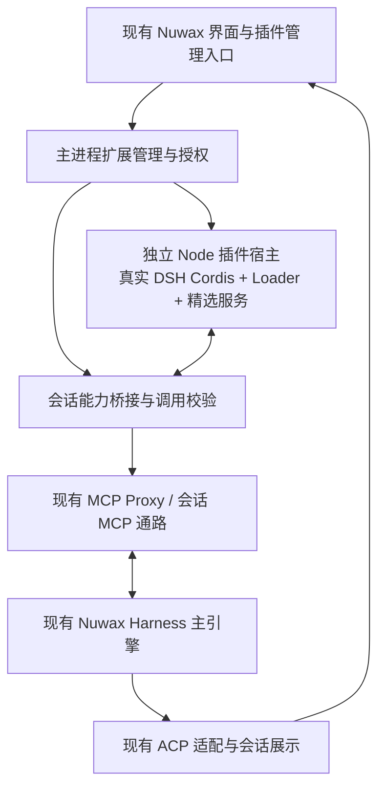

# 意图：保留 Nuwax 主引擎，分层兼容 DeepSeek Harness 插件生态

- 日期：2026-11-04
- 状态：研究草案；用户已选择“插件和生态可直接使用，保留现有主引擎”；本文的实现细节与分期尚未确认。
- 范围：Nuwax 客户端、嵌入前端与现有 Nuwax Harness 的扩展接口。本文不实施生产代码变更。

## 问题与预期结果

让用户在 Nuwax 中安装和管理 DSH 生态包，并在现有主引擎会话中使用经过验证的插件能力。对原样运行、内容导入、需要适配和不支持的情况分别给出明确结果；安装成功不能代表运行兼容。

“保留现有主引擎”包括保留其 Agent 循环、模型调用、原生会话和恢复职责。新增一个 DSH 插件宿主不等于切换主引擎。需要 DSH 完整 Agent 循环的插件不在本期兼容承诺内。

核心判断：应增加独立的生态插件宿主与能力桥接，先验证工具类插件；不应把 Electron 静态特性注册表改成可加载任意 npm 包的入口。完整 DSH 插件兼容还涉及模型步骤、会话事件与浏览器组件，不能由 ACP 或 MCP 接口单独实现。

## 调研基线与证据范围

| 对象 | 本次核对结果 |
|---|---|
| 客户端 | 已 fetch origin 并执行安全快进检查；`release/v3.1.0@ac47903e13056ffbe7e24bc17aca57da4068a285` 已是远程最新。 |
| 前端 | 已 fetch origin；远程 `feat-2026.11@8369d1900e6812519ea9c8129e1916980c990b65`；读取远程文件核对。客户端子模块工作树和 pin 保持 `5e8e0508ef092638c334eb266feea673a0fbeaea`，本次未更新 pin。 |
| DSH | 原本机 fork 停在 8 月；已 fetch 官方 master，并将干净的本地 master 安全快进至 `8bd073392eef6f54e921a093b95076248eb08cbb`（2026-11-03），未推送 fork。所查包版本为 `0.2.2-alpha.3`。 |
| Nuwax Harness | 客户端锁文件指向 adapter `1.2.25`、engine `0.18.26`；本地已安装包仍可见 adapter `1.2.24` / engine `0.18.24`。不能把本机 node_modules 当成当前锁定版本的运行验收。另只读核对 Nuwax engine 远程 `test@41463980a7d0dadec1dca531af083b63a564c969` 的动态工具实现，不等同该实现已通过客户端适配器开放。 |

本次结论来自源码和远程文档检查。未安装生态插件、调用付费模型、执行兼容原型或进行安装包验收；下文均为建议设计与待验证事项。

## 当前架构可以复用什么

1. `src/main/features/index.ts` 与 `_kit/types.ts` 已有 DesktopFeature、受信 IPC、登录失效、会话参与者和 disposer。这里明确采用静态注册，适合增加一个受信的“扩展管理”内建特性，承担宿主生命周期。
2. `services/engines/unifiedAgent.ts`、`acp/` 与 agent-kit 已有多引擎入口、MCP 配置、权限和会话更新通道。`acpClient.ts` 的 Codex 分支启动 Nuwax Harness adapter，并隔离 HOME / CODEX_HOME。
3. `services/featureHost.ts` 可以登记本地 MCP 服务，但它写入的是全局 `mcp_local_config`。会话授权令牌、项目插件选择不能直接落入这个全局设置。
4. `engineHooks.ts` 当前只有环境变量提供者与系统提示增强器，没有 DSH 所需的完整模型步骤和会话事件协议。
5. 前端 `src/services/plugin.ts` 和 `skill.ts` 管理平台插件与技能，依赖平台 API；它们不是 DSH 的 Node/Cordis 包运行时。可以在界面中统一发现入口，但保留各自安装、执行位置与权限来源。

## DSH 的插件机制与实际兼容边界

DSH 使用自己维护并重新命名的 `@deepseek-ai/cordis`、Loader 等包。插件声明服务依赖，通过 Context 注册服务、事件与可撤销副作用。仅安装普通 Cordis 或实现相似的 `apply(ctx)`，无法代替 DSH 的服务、隔离作用域和生命周期语义。

Profile 指定有序 Bundle；Bundle 的 `package.json.dsh.bundle` 指向配置 patch。组合顺序为 Bundle → profile patch → home patch → 调用时 patch。一个 patch 会替换目标条目的完整 config，不是逐字段合并。配置中的 `!!js` 可以执行表达式，属于代码信任面。

当前上游已有 Plugin Manager：安装、检查版本、选择 Bundle、切换条目、更新与恢复。它依赖 Loader / profileContext 等 DSH 设施，不是可直接复制到 Electron 的独立包管理函数；配置保存、依赖安装和运行时生效也是不同结果。

| 能力 | 保留主引擎的建议 | 本期承诺边界 |
|---|---|---|
| MCP 服务、纯技能文件 | 使用现有 MCP / Skill 通路，做格式与路径适配 | 内容或协议复用；不宣称等价运行 DSH 的 tool-skill 生命周期。 |
| 不依赖 Agent 状态的工具与服务 Provider | 在真实 DSH/Cordis 插件宿主中加载，经桥接供主引擎调用 | 优先原型；只有通过配置、声明、执行与取消验证的具体版本进入兼容清单。 |
| 按模型条件启用的工具、工具指导提示 | 适配工具准入、模型选择与提示贡献 | 需要引擎步骤接口验证；不能用始终导出工具替代条件准入。 |
| Todo、持久会话状态、用户问答 | 建立明确的执行身份、状态归属与 UI 投影适配 | 第二阶段候选；没有真实会话载体时拒绝加载或调用。 |
| 压缩、请求改写、Agent 调度、完整 subagent/goal 行为 | 需要主引擎的对应扩展点和行为映射 | 本期不承诺原样运行；不能靠转发 ACP 状态事件模拟。 |
| DSH Client UI / Chat 节点 / 双端插件 | 需要 DSH 的浏览器 Context、组件注册与通信设施 | 另期评估；普通 iframe 不等于兼容。 |
| 任意第三方 Node 插件 | 需要明确的代码信任与平台隔离策略 | 初期仅支持经过审核的版本；子进程隔离不能单独证明文件和网络权限受限。 |

### 三个需要保护的源码语义

- `dsh-tools` 的 `execute()` 走 Native/PTC executor 和 `tools/pre-execute → tools/execute → tools/post-execute`。桥接不能直接调用 `ToolDefinition.execute()` 绕开这些阶段；还需保留输出 schema、render、错误和取消结果。
- 上游 `dsh-tool-web` 的 `web_fetch` 注册了依赖 `modelSelection.provider` 的 `when`。`ToolsService.resolve()` 为每个模型步骤生成准入集合，没有准入集合时条件工具不可执行。故“加载所有工具然后导出 MCP”连这一类官方工具都不能直接覆盖。
- `dsh-tool-todo` 明确拒绝没有 `exec.agent` 的调用，并写入 `exec.agent.session`；`compaction-basic` 则监听 `agent/pre-step`、`agent/request` 和 Session。一个工具名或伪造的 sessionId 不能满足这些职责。

DSH 的 `ctx.agents.setFactory()` 允许由其他驱动提供 Agent，但实现者必须承担创建、真实 Session、作用域、事件时序、恢复、取消和清理。这是后续适配的可用接缝，不是已经存在的 Nuwax 兼容层。仅实现该接口，也不会自动获得主引擎内部的模型步骤控制。

## 建议的目标架构

图中插件宿主负责加载与执行生态能力；主引擎继续拥有模型循环。MCP 为第一阶段候选传输，不承担 DSH 生命周期模拟。需要步骤级准入和提示更新时，必须先补足引擎接口或将该插件标记为不支持。

### 1. 扩展管理与包配置

- 由一个内建 DesktopFeature 接入，扩展包代码不进入 Electron 主进程。
- 复用 DSH 的 Profile / Bundle / patch 解释与版本检查，Nuwax 维护兼容清单、授权和产品展示元数据；不要求第三方为安装而改写包。
- 固定 DSH 运行版本、Cordis 家族包、Node 与包管理器版本，避免同一插件树加载两套服务运行时。原型使用自定义 DSH profile / 自有 bridge bundle，验证正常 `dsh --profile` 启动；不直接套用包含模型循环、遥测和宽权限选择的完整默认组合。
- 扩展数据目录从当前产品 dataDir 派生；开发档案自然进入 `~/.nuwax-dev`，正式档案进入 `~/.nuwax`。不共享个人 DSH_HOME、其他产品配置或登录数据。
- 分别记录用户选择、已安装版本和实际运行版本。安装失败、激活失败与等待重启分别展示；只对可证明完整恢复的操作承诺回滚。
- 先采用运行期间固定插件版本、会话结束后应用更新的策略。运行时注销必须立即撤销后续调用权限，模块替换与升级可等待宿主重启。

### 2. 独立插件宿主

- 首先加载经过审核的工具、服务定义与 Provider 依赖闭包；复用上游 effects/disposer 和执行流水线。
- 插件宿主崩溃只使相关扩展不可用；不能带走登录、主窗口或所有引擎会话。正在执行的有副作用调用不自动重试。
- 初期可按账号/工作区隔离宿主；会话独立授权。对于无法证明状态隔离的插件，进一步按会话隔离进程，不能依赖共享全局可变状态。
- 包的 `inject`、manifest 和源码扫描用于发现依赖，兼容等级由实际组合测试确定；任意 JS 的隐式依赖不能靠静态扫描完全推导。

### 3. 能力桥接与权限

- 对外提供经过验证的工具 schema、工具说明、调用与取消；所有执行走 DSH 的 `ctx.tools.execute()`。保留模型可见的结构化结果和上下文贡献；不能只取字符串丢掉语义。
- 调用身份至少绑定产品档案、账号/服务域代次、工作区、业务会话、原生引擎会话、插件版本与 callId；主进程从拥有的会话推导，不信任页面自行填写的归属。
- 优先复用既有 MCP 通路建立最小闭环。需要 per-step 的 `when`、prompt section 或 `additionalContexts` 时，列为引擎适配项；不能把“调用前重新检查”宣传成完全等价的步骤准入。
- 现有 Nuwax engine 远程源码有动态工具实现，可作为后续直接桥接候选。必须先核对锁定二进制和 ACP adapter 的实际开放接口，再决定是否使用；本次不预设可用。
- 宿主文件、Browser、Computer Use 与商业服务继续经主进程授权。登出、换域、会话结束、插件禁用后撤销令牌，迟到结果不能写入新会话。
- 插件进程使用环境变量白名单，不继承 ticket、注册结果和全部业务凭据。包安装/构建脚本单独处理授权与环境。
- Cordis 的 `isolate` 是服务作用域，不是 OS 沙箱；Node 插件可以直接调用 Node API。经 broker 的授权只能保护 broker 管理的宿主能力。未建立 OS 权限约束前，产品只能承诺运行受信插件，不能承诺任意插件都受工作区权限限制。

### 4. 会话状态与前端扩展

- 当前主引擎会话仍是主对话的权威来源。插件执行记录独立保存，通过明确映射关联；不维护第二份可独立驱动主模型上下文的对话历史。
- 对 Todo 等状态插件，后续按真实 DSH Session 或经过完整实现的外部 Agent 驱动接入，并定义状态恢复与 UI 投影。只观察到 ACP 输出不能重建 DSH 的全部因果事件。
- 第一阶段提供统一插件管理和通用工具卡片。富界面以后通过受限声明式卡片或独立适配实现；不把第三方浏览器插件注入当前业务页使其取得 bridge 权限。
- 插件安装首先属于当前设备。纯 PC Web 没有本机宿主时，入口显示设备要求，不默认切换到云端执行。

## 用户角色、流程与产品字段

角色包括安装和启用插件的终端用户、维护受信兼容目录的管理员、发布 DSH 包的开发者。是否允许企业自建目录及组织范围自动分发，留待产品确认。

用户流程：选择包或目录 → 查看来源、版本、运行位置及兼容能力 → 校验依赖与权限 → 安装 → 为工作区/后续会话启用 → 新会话实际调用 → 查看运行状态和错误 → 禁用、升级或卸载。

建议的管理记录包含：生态类型、包名/精确版本、来源与内容校验信息、DSH 版本要求、已验证平台、能力贡献、兼容等级、账号/工作区范围、授权版本，以及安装状态和运行状态。兼容等级为“已验证原样运行 / 内容导入 / 需适配 / 不支持”，不要只显示一个“兼容”标记。

状态至少区分：未安装、安装中、安装失败、已安装未启用、启用中、运行中、等待重启、不兼容、运行失败。禁用后的现存调用取消策略必须明确，不能仅隐藏工具入口。

## 分期与可观察验收

### 第一步：先做兼容性原型，再承诺产品范围

目标是回答“保留主引擎时，哪些真实 DSH 插件能原样工作”。产物为可运行原型、具体包/版本矩阵与失败原因；通过后再细化实施规格。建议使用四类样本：

1. 一个不依赖 Agent、无条件准入的真实生态工具包，验证原包加载、服务依赖、schema 与执行流水线。样本需从实际生态挑选；自写 demo 只能辅助验证，不能证明生态兼容。
2. 官方 `dsh-tool-web + dsh-web-fetch-http`，检验模型条件准入、工具指导提示与取消。若步骤接口无法满足，应明确失败并作为下一阶段条件，不能删去 `when` 后报通过。
3. 官方 `dsh-tool-todo`，检验没有真实会话时拒绝，在具备会话适配后是否可恢复状态。
4. 官方 `compaction-basic` 或一个 UI 插件，验证系统能在不支持时明确阻止启用，而非安装后静默失效。

原型必须覆盖：主引擎确实未切换；两个会话不串状态；禁用后旧令牌失效；取消与子进程退出；宿主崩溃后主对话可继续；版本不匹配在执行前拒绝；权限拒绝确实没有产生对应宿主副作用。成功声明和失败原因都保存证据。

如果找不到有代表性的无条件工具样本，或真实插件普遍需要尚缺的步骤/Agent 接口，应先报告覆盖不足，再调整范围；不能以“支持 MCP”替代“兼容 DSH 插件”的验收。

### 第二步：发布受信工具插件兼容能力

完成插件列表、安装、配置、启停、错误诊断与会话绑定。以第一步通过的具体包版本作为首批目录；技能/MCP 内容复用单独标识。跨平台按真实原生依赖与包运行要求验收。发布使用本仓现有 CI 与安装包验证链，不为此次规划触发打包或发布。

### 第三步：按用户价值补生命周期与界面

优先选用户需要的两三类插件，再决定新增步骤准入、会话投影、问答或 UI 接口。若目标升级为任意 DSH 调度/压缩插件原样运行，需要另行选择完整运行时或深入改造主引擎循环；这不在当前已选择范围内。

## 建议的实现落点

| 位置 | 责任 |
|---|---|
| `src/main/features/extensions/`（建议新增） | 受信管理入口、生命周期、来源与宿主调用授权。 |
| 壳内独立 extensions 运行包（具体目录待原型确认） | DSH profile / bridge bundle、Node 插件宿主、包锁定与运行协议；不要把所有实现堆进 DesktopFeature。 |
| `services/engines/acp/` | 按会话绑定 MCP/工具能力，处理引擎能力差异；步骤级能力只在有真实接口时开放。 |
| `crates/agent-kit` | 仅下沉已被客户端与 CLI 实际共享的运行解析或协议，避免预先建立通用插件 SDK。 |
| 前端 `nuwax` | 管理界面、能力检查和插件状态；宿主桥类型按当前单一事实源生成。纯 Web 按可选能力消费。 |
| 根 `scripts/client/` 与资源配置 | 打包插件宿主所需 Node / DSH 运行时，记录来源和校验，遵守现有缓存与发布纪律。 |

首轮不要求改动平台后端。若后续需要组织插件目录或云端策略，由后端负责人按接口需求评估；不在 `agent-platform` 修复或提交。

## 约束、异常与待确认问题

- 当前 `release/v3.1.0` 的终端持久化、多终端、运行实例管理排除项继续有效。不能通过加载 DSH 默认 Bundle 间接引入；插件原型与后续交付独立安排。
- 安装成功但激活失败时，界面显示实际运行版本与错误；恢复旧版本失败要如实报告，不能只回滚 manifest 就宣布恢复。
- 网络失败、依赖构建拒绝、原生 ABI 不匹配、缺少必需服务、重复工具名、权限变化、会话已关闭、超时但子进程未退出分别给出可执行诊断。
- TODO（产品）：首批最有价值的具体生态包；先覆盖哪些平台；仅受信目录还是允许用户安装任意来源；安装启用范围的默认值。
- TODO（技术）：条件工具与工具提示能否通过当前锁定引擎提供严格等价的步骤准入；外部 Agent 驱动的最小真实实现成本；MCP 对附加上下文与输出块的保真能力；上游管理 API 在精简宿主中的依赖闭包。
- TODO（实施前）：确认首期兼容清单与成功标准，再收敛必要规格；不把研究草案视为已授权的引擎重构或发布计划。

## 源码依据

DSH 链接固定到本次核对 SHA，避免 master 漂移：

- [架构、Profile 与能力接缝](https://github.com/deepseek-ai/deepseek-harness/blob/8bd073392eef6f54e921a093b95076248eb08cbb/docs/architecture.md)
- [上游 Plugin Manager 行为与权限范围](https://github.com/deepseek-ai/deepseek-harness/blob/8bd073392eef6f54e921a093b95076248eb08cbb/packages/boot/plugin-manager/README.md)
- [插件版本检查实现](https://github.com/deepseek-ai/deepseek-harness/blob/8bd073392eef6f54e921a093b95076248eb08cbb/packages/boot/app-boot/src/plugin-compatibility.ts)
- [DSH Cordis 的上游版本与本地修改](https://github.com/deepseek-ai/deepseek-harness/blob/8bd073392eef6f54e921a093b95076248eb08cbb/vendor/README.md)
- [工具服务与步骤准入](https://github.com/deepseek-ai/deepseek-harness/blob/8bd073392eef6f54e921a093b95076248eb08cbb/packages/core/tools/src/index.ts)、[执行器输入](https://github.com/deepseek-ai/deepseek-harness/blob/8bd073392eef6f54e921a093b95076248eb08cbb/packages/core/tools/src/executor.ts)
- [web_fetch 的条件与提示贡献](https://github.com/deepseek-ai/deepseek-harness/blob/8bd073392eef6f54e921a093b95076248eb08cbb/packages/web/tool-web/src/fetch.ts)
- [Todo 的真实会话要求](https://github.com/deepseek-ai/deepseek-harness/blob/8bd073392eef6f54e921a093b95076248eb08cbb/packages/todo/tool-todo/src/index.ts)
- [压缩插件与模型循环的依赖](https://github.com/deepseek-ai/deepseek-harness/blob/8bd073392eef6f54e921a093b95076248eb08cbb/packages/compaction/compaction-basic/src/index.ts)
- [AgentFactory 扩展接口](https://github.com/deepseek-ai/deepseek-harness/blob/8bd073392eef6f54e921a093b95076248eb08cbb/packages/core/agent/src/index.ts)
- [ACP 的自动化范围与不支持项](https://github.com/deepseek-ai/deepseek-harness/blob/8bd073392eef6f54e921a093b95076248eb08cbb/packages/acp/acp/README.md)、[SDK 协议](https://github.com/deepseek-ai/deepseek-harness/blob/8bd073392eef6f54e921a093b95076248eb08cbb/packages/sdk/protocol/README.md)：两者都不是任意插件工具调用的现成网关。
- [Nuwax engine 动态工具实现，远程 test 快照](https://github.com/nuwax-ai/codex/blob/41463980a7d0dadec1dca531af083b63a564c969/codex-rs/core/src/tools/handlers/dynamic.rs)
